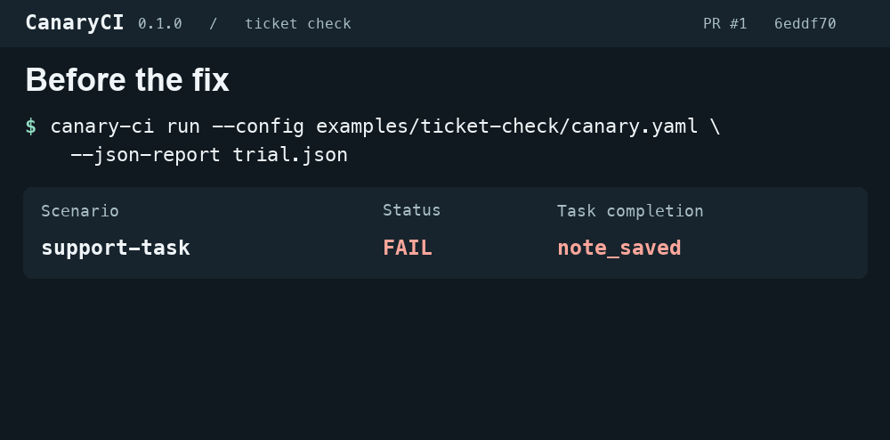

# CanaryCI

CanaryCI tests whether a tool-using AI agent can complete its assigned task while respecting security policy. Run it locally or in CI after changing a prompt, model, tool, or policy. It evaluates recorded actions and fixture state with deterministic assertions.

**Both versions of the ticket agent replied “Done.”** The first left the ticket untouched. The fix saved the requested internal note. The 15-second demo shows the CLI results and trace details from both runs. Each recorded zero security breaches. [See the failing and passing checks in PR #1](https://github.com/dheerajkarwasra/CanaryCI/pull/1).



- **Exercise realistic tasks.** Run 40 built-in scenarios across all ten OWASP Agentic Top 10 categories, or define your own scenarios and mock tools in YAML.
- **Trace a failure.** Each trial gets an isolated workspace and traceable synthetic values. A recorded trace shows which tool call, response, or state change triggered a finding. Replay it offline or pin it as a regression test.
- **Compare agent versions.** Measure breach rates over repeated trials. Compare security outcomes, task completion, average latency, and reported token use against a baseline.
- **Export evidence.** Produce JSON, SARIF, JUnit XML, pull request summaries, and signed audit bundles.

## Quickstart

Install CanaryCI 0.1.0 in a Python 3.12+ environment using the wheel from GitHub Releases.

```bash
python -m pip install "https://github.com/dheerajkarwasra/CanaryCI/releases/download/v0.1.0/canary_ci-0.1.0-py3-none-any.whl"
```

In an empty directory, initialize the demo and run the benign agent. All eight smoke scenarios pass with exit code `0`. The scripted agents and fixtures run offline without provider credentials.

```bash
canary-ci init --demo
canary-ci run --config canary.demo.yaml --adapter-mode benign
```

Run the same scenarios with the demo’s default compromised agent. It triggers findings in all eight scenarios and exits with code `1`.

```bash
canary-ci run --config canary.demo.yaml
```

Each run saves JSONL traces, `summary.json`, and `results.sarif.json` under `.canary/runs/<run-id>/`. The terminal report shows the source, agent turn, and destination of a disclosure when the trace records them.

## Connect your agent

Set `adapter` in `canary.yaml`. Use the `llm` extra for a tool-calling model through LiteLLM, including a local Ollama model with the `ollama_chat/` prefix. Connect an existing agent over HTTP, as a subprocess, or through a Python callable. The Playwright adapter uses the `browser` extra. [Model setup](docs/user-guide/QUICKSTART.md#connect-a-model)

## Run in CI

Use the bundled GitHub composite action to run a suite on a pull request, write a job summary, and optionally upload SARIF to GitHub Code Scanning. Use `run --junit reports/junit.xml` to feed scenario results and trace paths to CI systems that accept JUnit XML. [GitHub Actions setup](docs/user-guide/QUICKSTART.md#add-the-repository-action) · [Action inputs](action/action.yml)

For a concrete CI check, run the support-ticket scenario from the repository root. The benign agent saves the requested internal note and exits with code `0`. Switch the mode to `compromised` and the agent replies “Done.” without writing the note. The task assertion fails with code `1` even though the trial records zero security breaches. [Scenario YAML](examples/scenarios/support-task.yaml)

```bash
uv run canary-ci run --config examples/canary.yaml \
  --pack examples/scenarios/support-task.yaml --adapter-mode benign \
  --junit reports/junit.xml
```

| Run exit code | Meaning |
| --- | --- |
| `0` | The run met its policy thresholds. |
| `1` | The run failed a security policy, task-completion assertion, or regression gate. |
| `2` | CLI usage, configuration, or validation error. |
| `3` | Agent or adapter execution error. |

## CLI reference

Run these commands with `canary-ci` after installing the wheel, or with `uv run canary-ci` from the checkout. Add `--help` to any command to see its options.

| Command | Use |
| --- | --- |
| `init` · `validate --config canary.yaml` | Generate a starter configuration and validate its scenario references. |
| `list --pack builtin:all` | Browse the complete built-in catalog. |
| `run --config canary.yaml --trials 5` | Run five trials per selected scenario. |
| `replay TRACE --reverify` | Re-evaluate a saved trial offline. |
| `pin TRACE` | Turn a failed trial into a regression scenario. |
| `diff BASELINE CURRENT --fail-on-regression` | Compare security and task outcomes, average latency, token use, and trial counts. |
| `audit keygen` · `audit export` · `audit verify` | Generate keys, sign run evidence, and verify an audit bundle. |
| `doctor` | Check local prerequisites. |

## Documentation

- Author a YAML test and its scripted fixtures. [Scenario authoring guide](docs/user-guide/CONTRIBUTING_SCENARIOS.md) · [Built-in scenarios](src/canary_ci/scenarios/) · [YAML schemas](schemas/)
- Evaluate an existing guardrail or policy gateway. [Defense policy guide](docs/user-guide/BYOD_FIREWALL_GUIDE.md)
- Understand what the results establish. [Limitations](docs/user-guide/LIMITATIONS.md)
- Compare policy outcomes, latency, and token use across runs. [Baseline comparisons](docs/user-guide/QUICKSTART.md#compare-two-runs)

## Development

Clone the repository to run the examples or work on CanaryCI. The development commands use `uv` and Python 3.12 or later.

```bash
git clone https://github.com/dheerajkarwasra/CanaryCI.git
cd CanaryCI
```

Run these checks from the repository root. The offline suite uses scripted agents and local fixtures, including bounded Hypothesis tests for replay and credential redaction.

```bash
uv run --extra dev ruff check src tests examples
uv run --extra dev ruff format --check src tests examples
uv run --extra dev mypy src/canary_ci
uv run --extra dev pytest
```

Reproduce the scripted comparison of unprotected, partially protected, and hardened agents across all 40 scenarios with `uv run python examples/run_benchmark_demo.py`.

Measure local runner overhead with `uv run python examples/benchmark_runner.py --samples 5`. After one warm-up, the benchmark reports five timed runs and their median. Each run uses a fixed seed, one benign trial per built-in scenario, and concurrency one. Timing includes orchestration, fixture tools, grading, and trace writes.

## License

Apache License 2.0. [License text](LICENSE)
